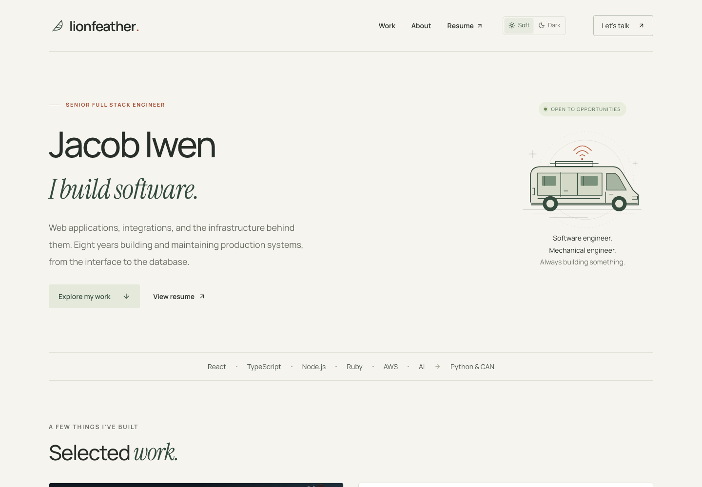

# Lionfeather

Jacob Iwen's personal engineering website. Built with React, TypeScript, and
React Router, with Vite running on Node.js. The production build is a static
site.



Run the commands below from the repository directory.

## Persistent local hosting

The built site uses **http://127.0.0.1:5174**. Its macOS launchd configuration
starts it at boot as your normal user and restarts it after an exit. Install
from a normal Terminal, without putting `sudo` before the npm command:

```sh
npm run service:install
```

This builds the site, installs its boot service, and verifies automatic restart.
macOS may request your administrator password for the specific installation and
launchctl operations. Preparing a plist alone does not register the service.

```sh
npm run service:status
```

After editing content, run `npm run build` and reload the browser. The server
reads the latest build without a restart. Only `dist/` is served. See
[service management](docs/local-hosting.md) for logs, lifecycle commands, and
the distinction between a manual process and installed boot supervision.

## Local development

Requires Node.js 22.12 or newer and npm.

```sh
npm ci
npm run dev
```

Open http://127.0.0.1:5175 for Vite live updates. This separate development port
can run alongside the persistent site. It binds to loopback and fails clearly
if its port is occupied. Stop a foreground server with Ctrl+C.

`npm start` serves the existing production build on port 5174 in the foreground;
use it only when the managed service is stopped. It does not install persistence.

## Build and verify

```sh
npm run build
npm test
npm run preview
```

The build runs TypeScript checking, generates `dist/`, and checks the output
for private files and known private source references. The preview is at
http://127.0.0.1:4173. The artifact check rejects unexpected files, symlinks,
source maps, common credential patterns, private addresses, and changes to
reviewed images/PDFs. It does not replace content review.

`npm run format:check` checks formatting; `npm run format` formats project files.

Also verify navigation, direct project URLs, mobile layout, keyboard use,
email copying, and the resume download in a browser.

## Content

- `src/main.tsx`: application entry for fonts, styles, the development palette
  panel, and `<App />`.
- `src/App.tsx`: layout shell and route rendering.
- `src/pages/`: route components for the homepage, project pages, recommendation
  letter, and 404 page.
- `src/pages/home/`: homepage sections, including project features,
  recommendation, about, and contact.
- `src/components/layout/`: shared header, footer, Soft/Dark theme toggle, and
  page-position components. `public/theme.js` applies the saved appearance
  before rendering; screenshot pixels stay unchanged.
- `src/components/projects/`: project previews, figures, galleries, and the
  signal-discovery diagram for the dashboard, Form Engine, Fieldwork, and
  telemetry projects. The dashboard preview is cropped on the homepage and shown
  whole on its project page. Demo readings and simulated conversations are
  labeled.
- `src/components/screenshots/`: shared compact screenshot navigation, figures,
  full-screen viewer, and hooks for Fieldwork, van telemetry, and dashboard
  screenshots, with keyboard controls and full-size links.
- `src/components/BoldText.tsx` and `src/components/Illustrations.tsx`: bold
  text rendering for content strings and original SVG feather and van
  illustrations.
- `src/content/`: project write-ups, public contact links, Henry Broddle's
  recommendation letter, and screenshot records.
- `src/routes.ts`: route paths and route helpers.
- `src/styles/`: responsive visual design and page-area styles.
- `public/Jacob-Iwen-Resume.pdf`: public resume download.

Fonts are packaged locally. No analytics, tracking, external font service,
contact-form service, or live device connection is included.

## Deployment

Cloudflare Workers Static Assets is configured for **https://lionfeather.dev**
in `wrangler.jsonc`. Only `dist/` is uploaded. Single-page application routing
supports direct links such as `/work/van-dashboard`. Cloudflare hosts the files
independently of the Mac's local service and manages the domain's DNS and HTTPS
certificate. No server-side Worker script or paid Workers plan is needed.

First, authorize Wrangler from Terminal using the Cloudflare account that owns
`lionfeather.dev` (browser sign-in and consent are required):

```sh
npm run cloudflare:login
```

Publish the site, and publish subsequent updates, with:

```sh
npm run deploy
```

This builds and checks the public artifacts before uploading them and attaching
the custom domain. The Cloudflare zone must be active. If a conflicting DNS
record already exists, inspect it before approving replacement. After the first
deployment, allow DNS and certificate provisioning to finish, then verify the
homepage, direct project URLs, and resume download at https://lionfeather.dev.

`npm run deploy:check` builds and validates the deployment without publishing.
Configuration alone does not mean the site has been deployed. The bare domain
is configured; `www.lionfeather.dev` is not currently attached.

Both deployment commands also run `npm run check:resume`, which refuses to
publish a stale resume. It reads the resume repository's location from ignored
`.local/resume-source.json` (`checkout`, plus `contentMaster` and `versions`
paths relative to it), finds the version directory the Markdown content master
says it was synchronized to, confirms that directory's `resume.md` snapshot and
`verification.json` agree with it, and requires `public/Jacob-Iwen-Resume.pdf`
to be byte-identical to that version's `*_public.pdf`. A newer `v<N>` directory
that already holds a public PDF also fails the check until the master names it.
When it fails, it prints the copy command and the hash to record in
`scripts/public-assets.json` after reviewing the new PDF. The ordinary build
does not need the resume repository or this file.

### Privacy checks before publishing

`scripts/public-assets.json` lists reviewed public files and pins the hashes of
images, the approved resume, fonts, and security headers. Adding files or changing
those bytes blocks the build until the content and metadata are reviewed and the
inventory is deliberately updated. Do not regenerate hashes just to pass a check.
Inspect image pixels and PDF text/links as well as metadata; text scanning cannot
find all sensitive content inside binary files. Keep audit extracts outside
`public/`, under ignored `.local/`.

The deployment check also requires `dist/` as the only upload directory and rejects
unreviewed Wrangler options, including backend code, environment bindings, and
build commands. Source maps and private files are excluded. CLI telemetry is off.

Cloudflare's `public/_headers` policy blocks browser API calls, WebSockets,
form submissions, embedded pages, and external subresources. Local bundled and
inline fonts remain allowed. External links still work when deliberately opened,
without sending a referrer. The local macOS static server does not interpret this
Cloudflare-specific file; validate these headers through Wrangler or the deployed
site. See [Cloudflare headers documentation](https://developers.cloudflare.com/workers/static-assets/headers/).

These controls do not make the site anonymous: the approved name, public email,
GitHub link, resume, and portfolio text are intentionally public. Cloudflare still
receives the website files during deployment and normal visitor requests when
hosting it. No scanner can prove the absence of every possible secret.

The repository can remain private while the built website is public. Local
notes, environment files, handoffs, build output, and dependencies are ignored.
`package.json` sets `private: true` to prevent accidental npm publication; this
does not configure GitHub repository visibility.
